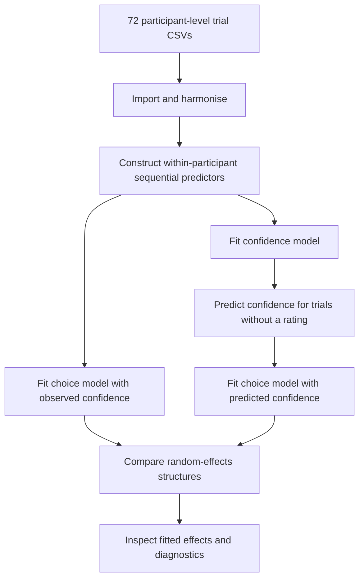
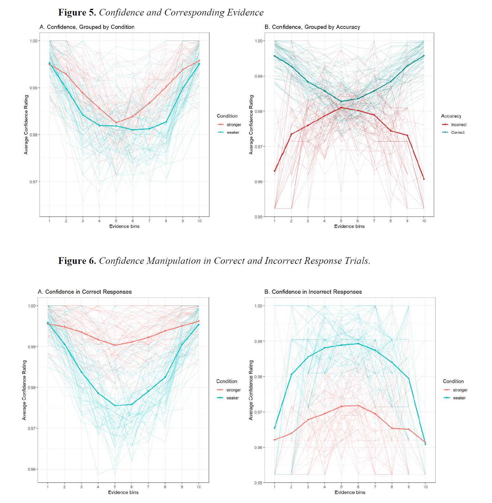
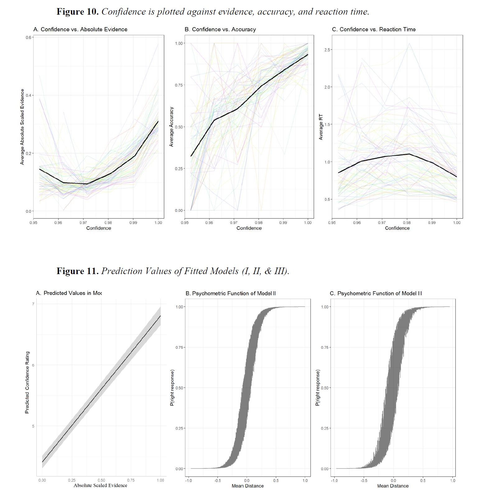

# Sequential Decision-Making: Mixed-Effects Models

An R analysis of trial-level data generated by the [Beehive perceptual decision experiment](https://github.com/MahdiMoocavi/Beehive-Paradigm). The models examine how current sensory evidence, previous-trial information, and confidence relate to choice behaviour.

This repository is the analysis component of a broader experiment-to-analysis project:

- [Beehive Paradigm](https://github.com/MahdiMoocavi/Beehive-Paradigm) — PsychoPy experiment and trial-level data generation.
- **This repository** — mixed-effects analysis of the resulting participant-level trial data.

## Research focus

The analysis connects experimental manipulations of post-decisional evidence with participants' subsequent decisions and confidence judgments. It separates trials with observed confidence ratings from trials without an observed confidence rating, using a first-stage confidence model to generate predictions for the latter.

## Analysis workflow



## Model overview

- **Model I — confidence:** linear mixed-effects model predicting confidence from previous-trial condition and accuracy, with participant-level random effects.
- **Model II — observed confidence:** logistic mixed-effects model of the current response using current evidence, previous-trial evidence variables, and observed confidence.
- **Model III — predicted confidence:** logistic mixed-effects model for trials without an observed confidence rating, using confidence values predicted by Model I.

The script compares random-intercept and random-slope specifications and generates descriptive and predicted-effect visualisations.

## Selected figures

The following PNGs are the original figure-page images uploaded for this project. They are embedded here unchanged.

**Figures 5 and 6 — confidence across evidence conditions and response accuracy**



**Figures 10 and 11 — confidence relationships and fitted model predictions**



## Implementation

- **Language:** R
- **Main script:** `sequential_decision_models.R`
- **Core modelling package:** `lme4`

Install the required packages:

```r
install.packages(c(
  "ggplot2", "gridExtra", "effects", "dplyr", "scales",
  "psych", "lme4", "performance", "car", "ggeffects",
  "lmerTest", "rstudioapi"
))
```

## Input data

The script expects 72 participant-level CSV files named `DotsTask_sub1.csv` through `DotsTask_sub72.csv`. These files are generated by the Beehive experiment and must follow its trial-level output schema. Participant-level data are not included in this repository.

Required columns include participant, block, and trial identifiers; response; pre-decisional evidence; confidence judgment; experimental condition; accuracy; run/trial type; and reaction time. The script checks for the required columns before proceeding.

## Data processing and interpretation

Sequential predictors are constructed within participant after sorting trials, so the final trial of one participant cannot become the previous trial of another. Practice trials, first trials in blocks, and trials without valid current or previous responses are excluded from the modelling dataset.

The figures are descriptive and model-based visualisations from the analysis script; they should be interpreted alongside the model specifications and the original study design. Model convergence, random-effects structure, and residual diagnostics should be examined with the original data before interpreting model comparisons. The script currently displays plots in the active R graphics device rather than saving a complete report automatically.

## Reproducibility

1. Place the 72 participant CSV files beside the R script.
2. Open the project directory in R/RStudio.
3. Install the packages listed above and run `sequential_decision_models.R`.

The original participant data are not distributed here, so the full analysis cannot be reproduced from this repository alone.

## Related project

- [Beehive Paradigm](https://github.com/MahdiMoocavi/Beehive-Paradigm) — experimental implementation and trial-level data generation.
