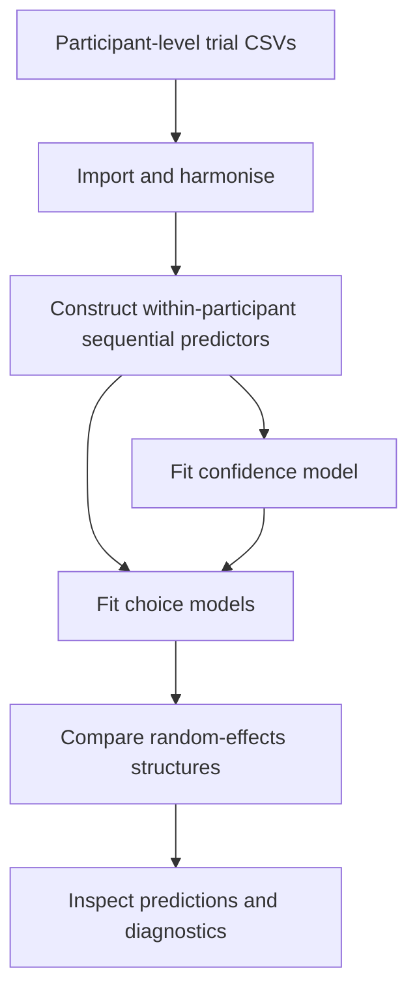

# Sequential Decision-Making: Mixed-Effects Models

An R analysis of trial-level data generated by the [Beehive perceptual decision experiment](https://github.com/MahdiMoocavi/Beehive-Paradigm). The models examine how current sensory evidence, previous-trial information, and confidence relate to choice behaviour.

## Research focus

The analysis connects experimental manipulations of post-decisional evidence with participants' subsequent decisions and confidence judgments.

## Analysis workflow



## Model overview

- **Confidence model:** linear mixed-effects model predicting confidence from previous-trial condition and accuracy, with participant-level random effects.
- **Observed-confidence model:** logistic mixed-effects model of responses using current evidence, previous-trial variables, and observed confidence.
- **Predicted-confidence model:** logistic mixed-effects model for trials without an observed confidence rating, using confidence values predicted by the first model.

The script compares random-intercept and random-slope specifications and generates descriptive and predicted-effect visualisations.

## Implementation

- **Language:** R
- **Main script:** `sequential_decision_models.R`
- **Core modelling package:** `lme4`

Install the required packages:

```r
install.packages(c(
  "ggplot2", "gridExtra", "effects", "dplyr", "scales",
  "psych", "lme4", "performance", "car", "ggeffects",
  "lmerTest", "rstudioapi"
))
```

## Input data

The script expects 72 participant-level CSV files named `DotsTask_sub1.csv` through `DotsTask_sub72.csv`. These files are generated by the Beehive experiment and must follow its trial-level output schema. Participant-level data are not included.

## Analysis considerations

Sequential predictors are constructed within participant after sorting trials, so the final trial of one participant cannot become the previous trial of another. Practice trials, first trials in blocks, and trials without valid current or previous responses are excluded from the modelling dataset.

Model convergence, random-effects structure, and residual diagnostics should be examined with the original data before interpreting model comparisons. The script currently displays plots in the active R graphics device rather than saving a complete report automatically.

## Related project

- [Beehive Paradigm](https://github.com/MahdiMoocavi/Beehive-Paradigm) — experimental implementation and trial-level data generation.
